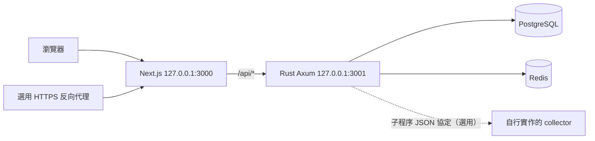

# 架構

## 訂閱配對（MT-096）

訂閱只保存預期扣款（`subscriptions`），不寫入 `transactions`；金額一律來自收支清單（`FEED_SQL`，手動＋同步）。`GET /subscriptions/month?month=YYYY-MM` 在讀取時計算配對：比對字串（`category_text` 正規化）選出候選交易，最長字串決定歸屬，一樣長時金額相符的訂閱優先、金額也相符再取扣款日最近者（同一代收商可依金額拆成多個訂閱；共用字串且都「只配對相同金額」而金額皆不符的交易不歸任何訂閱）；期別為離交易日最近的扣款日；外幣以原幣比較。使用者決定存於 `subscription_links`（confirmed／rejected），優先於自動配對。外幣服務費行依「簽帳 金額」或「-商家」連到同一期的扣款並沿用其狀態。其他端點：`GET/POST /subscriptions`、`PUT/DELETE /subscriptions/{id}`、`PUT /subscriptions/{id}/links`、`DELETE /subscriptions/{id}/links/{transaction_id}`、`GET /subscriptions/suggestions`、`GET /subscriptions/matches`（近 13 個月已歸到訂閱、非待確認的交易 id 與訂閱名稱／期別，供收支清單與交易明細標示）、`POST /subscriptions/suggestions/dismiss`。自訂圖示以 `PUT/DELETE /subscriptions/{id}/icon` 管理（前端縮成 128px，依檔頭只收 PNG／JPEG／WebP，≤64 KB），存於 `subscriptions.icon_photo`，讀取時以 data URL 放在訂閱的 `icon` 欄位回傳。每期的 `excluded` 列出使用者排除的交易，可用 `DELETE /subscriptions/{id}/links/{transaction_id}` 還原；`GET /subscriptions/suggestions/dismissed` 與 `POST /subscriptions/suggestions/restore` 用於找回按過「不是訂閱」的商家。三張表皆為擁有者 RLS；家庭檢視沿用既有唯讀 GET 規則，前端行事曆與訂閱寫入入口在檢視他人時隱藏。

## 程序與模組

`apps/web` 處理介面、查詢快取與使用者操作；不持有資料庫及 Google OAuth secret。`apps/api` 負責身分、授權、帳務、排程及同步入庫。資料來源採集器（collector）不隨公開版提供；若自行實作，透過子程序 JSON 協定接收工作，不直接取得資料庫存取權，協定見[金融來源](financial-sync.md)。

PostgreSQL 是永久資料來源。Redis 提供快取、限流與通知；同步工作保存於資料庫。API、排程及工作消費器同在 Rust 程序。未支援來源不接受手動排程，也不產生每日工作；既有佇列中的未支援來源會取消，保留帳務資料。這是 Windows 自行架設架構，尚未提供跨平台安裝流程。

## 身分與資料隔離

PostgreSQL 管理連線另存於 `.local/postgres-admin.dpapi`，以 Windows 使用者 DPAPI 保護，與應用的 `.local/secrets.dpapi` 分離。僅維運腳本透過 `Invoke-PostgresAdmin` 暫時載入 libpq 環境變數，結束或失敗時恢復呼叫者環境；一般服務啟動不讀取管理登入檔。

Google OAuth 使用 PKCE、state 與 nonce；每次啟動登入都帶 `prompt=select_account`，讓 Google 顯示帳號選擇器，而不直接沿用瀏覽器中的既有 Google 工作階段。登入後發給 opaque session cookie，資料庫保存 token 雜湊。寫入操作檢查 Origin 與 CSRF。每個財務 transaction 設定 owner context，應用資料庫角色與 PostgreSQL RLS 共同限制資料範圍。

家庭檢視與資產分享只公開明確授權的唯讀資料；家庭檢視的非 GET 操作由後端拒絕。介面管理員權限與主機維運權限不同，主機管理者仍屬信任範圍。

### 家庭合併（MT-094）

`GET /api/v1/household/summary` 以各成員自己的 owner context 逐人讀取 TWD、非待入帳的收支明細，再於 Rust 合併；成員只能從自己可檢視的人中挑選，其餘回 404。

- 共同帳戶去重：同步帳戶以「來源＋末四碼」識別。同一帳戶出現在多人帳本時，相同日期、金額、摘要的交易只算一次；同一成員自己的重複交易不受影響。合併淨資產尚未去重，回應以 `shared_accounts` 提示。
- 家庭內互轉：一位成員轉出、另一位成員 3 天內轉入相同金額，且至少一邊屬資金移動分類、帶 `transfer_peer` 或摘要含轉帳字樣，即配對排除於家庭收支；每筆最多配對一次，日期最近者優先。配對清單以 `internal_transfers` 回傳供使用者核對。成員個人的收支數字不套用此排除。
- 本月摘要：`compare` 以上月同一段日期比較（本月未結束時只比到今天）；`budget` 為成員本月 TWD 預算加總；另回傳各成員最近成功同步時間、超過 48 小時未同步及登入失敗的來源數，以及未計入的外幣交易數。

`GET /api/v1/household/explore?members=&a_members=&b_members=&a_from=&a_to=&b_from=&b_to=` 為家庭支出追查：`members` 為要載入的成員（A、B 聯集），`a_members`／`b_members` 為兩邊各自的成員（省略為全部），期間含首尾。與 summary 相同，逐成員以 owner context 讀取，套用共同帳戶去重與家庭內互轉排除，只計 TWD 支出；回傳兩段期間的每筆支出明細、A 結束月往前 12 個月的分類×成員月支出與排除筆數。分組、比較、圓餅與下鑽都由前端依明細計算。單段期間上限 400 天、整體載入範圍約三年、明細 20,000 筆。

`GET /api/v1/household/upcoming?days=7|30` 列出成員啟用中的固定支出排程（狀態 `scheduled`，不代表已付款）與已同步信用卡帳單（往前 14 天內未繳者仍列出）。帳單狀態只依來源 `is_paid`／`paid_amount`：過了繳款日但來源未標示已繳，顯示為 `overdue`「未見繳款紀錄」，不推測為已繳。本週與期間待付合計只加總 TWD 未繳項目。

執行設定以 Windows 使用者 DPAPI 儲存於 `.local/secrets.dpapi`，資料來源設定及 session 由應用加密後入庫。DPAPI 綁定目前 Windows 使用者／環境；備份不是任意電腦可直接解密的可攜格式。

## 同步資料

### 同步 log 與錯誤診斷

每個同步工作的逐行事件存於 `sync_job_events`（owner RLS，每工作最多 500 筆，保留 30 天，工作刪除時連帶刪除）。失敗工作另記 `sync_jobs.error_code` 與 `failed_step`，前端依錯誤碼顯示原因與建議動作。

- 事件來源：Rust 在排入佇列、開始、步驟切換、登入許可、圖形驗證碼重試、等待本人驗證、收到結果、寫入、逾時、取消及租約到期時寫入事件。collector 以 `{"type":"log","level","code","detail","count"}` 回報白名單代碼（`collector_warning`、`detail_errors`、`warnings_truncated`），`failed` 訊息附帶錯誤摘要 `detail`。
- 遮罩：顯示文字一律由後端依代碼產生。collector 的摘要先在 collector 端遮罩，Rust 寫入前再遮罩一次，處理 Email、身分證、網址路徑與查詢、長 token 及 4 位以上數字，並截斷為 200 字。事件不含帳密、cookie 或完整帳號。
- API：`GET /api/v1/sync/jobs/{id}/log?after=N` 回傳工作快照與後續事件（每次最多 200 筆）。`GET /api/v1/sync/jobs/{id}/events` 是單一工作的 SSE，連線後先重播歷史，之後每秒推送 `log`（事件 id 即資料表 id，支援 `Last-Event-ID` 或 `?after=` 接續）及 `job`（快照有變化時）；工作結束後送出 `done` 並關閉。非擁有者一律 404。原有 `/sync/events` 仍負責工作清單。
- 協定相容性：舊版 Rust 會把 `log` 訊息視為未知類型並中止同步，因此 collector 與 Rust 必須一起部署。

## 目錄與依賴

| 目錄                             | 職責                                 |
| -------------------------------- | ------------------------------------ |
| `apps/web/src/features`          | 依功能分離的前端頁面                 |
| `apps/api/src`                   | 身分、帳務、分享、同步與 HTTP 路由   |
| `apps/api/migrations`            | 必須按順序保留的資料庫 schema 版本   |
| `apps/api/tests`                 | 資料庫整合測試                       |
| `apps/api/examples`              | OpenAPI 匯出及合成 UI fixture        |
| `scripts`                        | 不依賴私人研究的管理與建置工具       |
| `scripts/tests`                  | UI／傳輸檢查，需獨立設定測試環境     |
| `.local`                         | Git 排除的機密、備份、研究與執行資料 |

Python 備份只依賴 `windows_dpapi.py` 的資料保護介面，不再引用私人設定表單。公開建置不依賴相鄰的參考專案或本機研究目錄。

## 成員活動時間（MT-099）

`users.last_active_at` 保存最後通過 session 與適用 CSRF／家庭檢視授權檢查的請求時間，最密每 30 秒更新一次。家庭檢視只記錄實際登入者，不將操作歸屬於被檢視者。欄位獨立於 sessions，因此登出與過期 session 清理不會抹除活動時間。migration 0023 不回填舊紀錄。

管理員 `GET /api/v1/admin/users` 新增可為 null 的 `last_active_at`；保留既有 `last_login` 相容欄位。前端以「最近活動」呈現新欄位，null 顯示「尚無活動紀錄」；舊 API 尚未提供欄位時維持登入時間標示。

已登入的可見頁面每 30 秒重取 `/auth/me` 作為活動心跳；成員頁每 15 秒讀取清單，切回頁面立即重取，背景停止定時網路輪詢。相對時間另由 15 秒時鐘重繪，不依賴 API 資料是否改變。活動含可見頁面停留及其他已驗證 API 請求，不代表鍵鼠操作或嚴格的在線狀態；瀏覽器休眠、計時器節流及網路延遲會影響更新速度。
